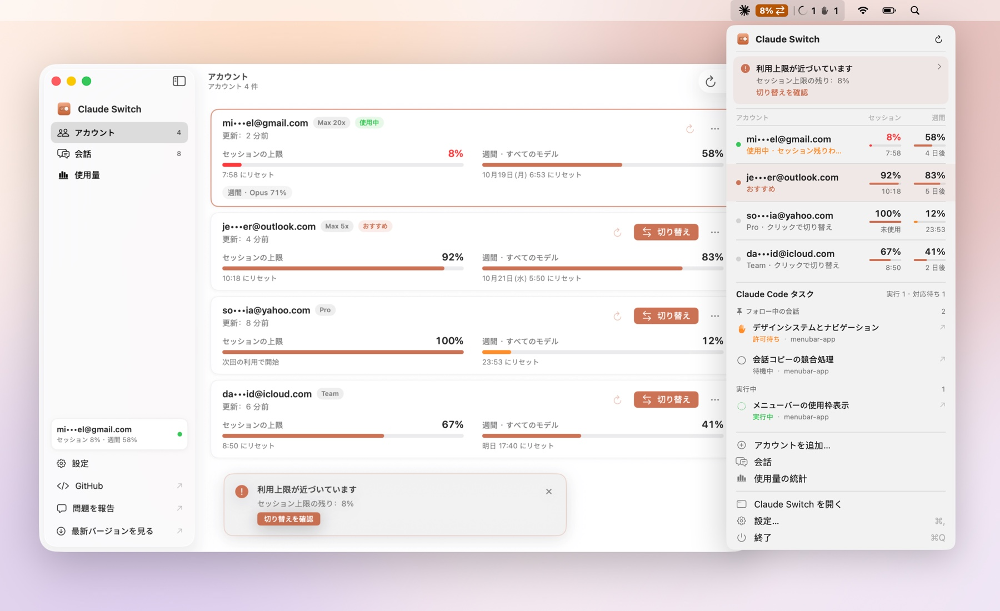

<div align="center">


# Claude Switch

**Claude Desktop のすべてのアカウントを、Mac のメニューバーからワンクリックで。**

各アカウントのログインは一度保存すれば、いつでもすぐに切り替え。セッションの上限と週間の上限もひと目でわかります。

[](https://github.com/uiuing/claude-desktop-switch/releases/latest)
[](https://github.com/uiuing/claude-desktop-switch/releases)


[](LICENSE)

[English](README.md) · [简体中文](README.zh-CN.md) · [繁體中文](README.zh-TW.md) · **日本語**

<br>

<picture>
  <source media="(prefers-color-scheme: dark)" srcset="docs/images/hero-ja-dark.jpg">
  
</picture>

</div>

## Claude Switch とは

Claude Desktop は一度に 1 つのアカウントにしかサインインできません。個人用と仕事用のアカウントを使い分けたり、プロジェクトごとに別のプランを使ったりしていると、切り替えのたびにサインアウトとサインインが必要で、各アカウントの残り使用量も把握しにくくなります。

Claude Switch は、使っているログインを暗号化して Mac に保存し、切り替えを代わりに行います。Electron ではないネイティブのメニューバーアプリで、常駐するバックグラウンドサービスやサードパーティの依存関係もありません。

## 主な機能

- **ワンクリックで切り替え**：メニューバーでアカウントを選ぶと、Claude を通常どおり終了し、保存したログインに入れ替えて、サインインした状態で再び開きます。
- **上限をひと目で確認**：各アカウントの **セッションの上限** と **週間の上限** の残りとリセット時刻を表示します。プランにモデル別の週間上限がある場合はそれも表示します。
- **おすすめの提示**：使用中のアカウントが残りわずかになると、まだ余裕のある保存済みアカウントをメニューバーで示します。
- **サインアウトせずにアカウントを追加**：「アカウントを追加」は現在のログインを一旦退避し、Claude をサインイン画面で開きます。元のアカウントはサーバー側でサインアウトされず、引き続き使えます。
- **Claude Code のセッションも一緒に**：ローカルの Claude Code セッションを別のアカウントへ移動・コピーしたり、切り替えのたびに指定したセッションを自動で連れて行ったりできます。
- **使用量の統計**：トークン、モデル、アクティビティのヒートマップ、連続日数、日別グラフを、Claude Desktop 自身の統計と同じ方法で集計します。
- **安全な設計**：暗号化したスナップショット、厳格なファイルの許可リスト、中断した切り替えを元に戻せる操作ログ。自分で更新しない限りネットワーク通信は行いません。詳しくは [仕組み](docs/how-it-works.md)（英語）をご覧ください。
- **macOS になじむ使い心地**：SwiftUI、ライト／ダークモード、キーボードショートカット、10 の表示言語に対応。

## スクリーンショット

<table>
  <tr>
    <td width="50%">
      <picture>
        <source media="(prefers-color-scheme: dark)" srcset="docs/images/conversations-dark.png">
        
      </picture>
      <p align="center"><b>会話</b> · アカウント間でセッションを移動・コピー・追従</p>
    </td>
    <td width="50%">
      <picture>
        <source media="(prefers-color-scheme: dark)" srcset="docs/images/usage-dark.png">
        
      </picture>
      <p align="center"><b>使用量</b> · トークン、モデル、ヒートマップ、連続日数</p>
    </td>
  </tr>
</table>

<sub>スクリーンショットはすべて内蔵のサンプルデータを使い、<code>scripts/screenshots.sh</code> で生成しています。</sub>

## インストール

**動作環境**：macOS 14 Sonoma 以降（Apple シリコン／Intel）、[Claude Desktop](https://claude.ai/download) がインストール済みであること。

1. [最新リリース](https://github.com/uiuing/claude-desktop-switch/releases/latest) から `ClaudeSwitch-<バージョン>-macOS.zip` をダウンロードします。
2. 解凍して **Claude Switch** を「アプリケーション」フォルダに移動します。
3. 起動します。まだ Apple の公証を受けていないため、初回のみ次の操作が必要です。
   - macOS 15 以降：**システム設定 → プライバシーとセキュリティ** を開き、下にスクロールして **このまま開く** をクリックします。
   - macOS 14：アプリを右クリックして **開く** を選び、確認します。

   ターミナルでダウンロード時の隔離属性を外すこともできます。

   ```sh
   xattr -dr com.apple.quarantine "/Applications/Claude Switch.app"
   ```

各リリースのダウンロードには SHA-256 チェックサムを添えています。

### アップデート

Claude Switch には **現在、リモート更新や自動アップデートはありません**。新しいバージョンを知るには、このリポジトリで **Watch → Custom → Releases** を設定するか、[Releases](https://github.com/uiuing/claude-desktop-switch/releases) ページをご確認ください。新しいバージョンをダウンロードしたら、「アプリケーション」内の古いものと置き換えます。保存したアカウントは Mac に残ります。新しいバージョンが Claude Switch のキーチェーン項目を使う許可を macOS が一度求めることがあるので、**常に許可** を選んでください。

## はじめかた

1. いつもどおり **Claude Desktop にサインイン** してから Claude Switch を開くと、そのアカウントが自動で保存されます。
2. メニューバーの **アカウントを追加…** をクリックします。Claude がサインイン画面で再起動するので、別のアカウントでサインインすると、そちらも自動で保存されます。
3. あとはメニューバーやアカウントウインドウから、いつでも **切り替え** できます。

> [!IMPORTANT]
> アカウントの切り替えには Claude Switch を使い、Claude の **ログアウト** や Claude Code の `/login` は使わないでください。
> サインアウトすると Anthropic 側でそのログインが無効になり、Claude Switch が保存したコピーも使えなくなります。
> その場合はアカウントが **無効** と表示されるので、もう一度サインインすれば再び保存されます。

メインウインドウのショートカット：`⌘1` `⌘2` `⌘3` でページ切り替え、`⌘K` でアカウントと会話を検索、`⌘R` でローカルデータを再読み込み。

## プライバシーとセキュリティ

- **データは Mac の中だけに**：保存したログインは AES-256-GCM で暗号化され、鍵はログインキーチェーンに保管されます。iCloud には同期されず、保存したログインだけをコピーしても読み取れません。
- **テレメトリ、解析、独自サーバーは一切ありません。**
- **ネットワークは必要なときだけ**：使用中のアカウントの上限を更新するときに、Claude Code の `/usage` コマンドと同じ読み取り専用のリクエストを Anthropic に直接送ります。ほかのアカウントの分は送りません。ローカル記録の読み込みには通信は不要です。
- **影響範囲は最小限**：入れ替えるのは Claude Desktop のログインファイルだけです。Claude Code 自身のログイン、プロジェクト、MCP サーバー、スキル、設定には触れません。
- **元に戻せる**：切り替えはすべて記録され、途中で中断しても切り替え前の状態に戻せます。

詳細（英語）：[仕組み](docs/how-it-works.md) · [上限と使用量のデータ](docs/usage-data.md) · [セキュリティポリシー](.github/SECURITY.md)

## よくある質問

<details>
<summary><b>macOS が「Claude Safe Storage」の使用許可を求めてくるのはなぜですか？</b></summary>

Claude はこのキーチェーン項目の鍵でログイントークンを暗号化しています。Claude Switch がこれを使うのは、使用中のアカウントの上限をオンラインで読み込むときだけで、確認が表示されるのも自分で更新ボタンを押したときだけです。**常に許可** を選べば以降は表示されません。ほかの機能には必要ありません。
</details>

<details>
<summary><b>Claude Code の CLI も切り替わりますか？</b></summary>

いいえ。Claude Switch が切り替えるのは Claude Desktop です。Claude Code のコマンドラインツールは独自のログインを持ち続けます。
</details>

<details>
<summary><b>「—」や古い数値が表示されるアカウントがあるのはなぜですか？</b></summary>

上限は Claude Desktop が Mac に残している記録から読み取ります。最近使っていないアカウントには新しい記録がなく、ほかのデバイスでの使用量もローカルでは見えません。各数値には読み取った時刻が表示されます。
</details>

<details>
<summary><b>保存したアカウントを別の Mac に移せますか？</b></summary>

ファイルをコピーするだけでは移せません。保存したログインは、この Mac のログインキーチェーンにある鍵でしか読み取れないためです。移行アシスタントやバックアップからユーザアカウントごと復元した場合はキーチェーンも引き継がれるため、保存したアカウントをそのまま使えることがあります。そうでなければ、新しい Mac で各アカウントに一度サインインすれば再び保存されます。
</details>

<details>
<summary><b>Claude Desktop のアップデートで動かなくなりませんか？</b></summary>

Claude Switch は Claude Desktop のローカルファイル形式に依存しており、これは公開 API ではありません。認識できない形式を見つけた場合は推測せずに停止し、何も変更しません。そのような場合は [Issue](https://github.com/uiuing/claude-desktop-switch/issues/new/choose) でお知らせください。
</details>

## ソースからビルド

Xcode 16 以降（Swift 6 ツールチェーン）が必要です。

```sh
git clone https://github.com/uiuing/claude-desktop-switch.git
cd claude-desktop-switch
swift test                               # ユニットテスト
zsh scripts/build.sh                     # "dist/Claude Switch.app" を作成
open "dist/Claude Switch.app" --args --demo   # サンプルデータで試す
```

`scripts/build.sh --read-only` を使うと、表示はすべてできるものの Claude のファイルを決して変更しないバージョンをビルドできます。詳しくは [アーキテクチャ](docs/architecture.md) と [コントリビューションガイド](.github/CONTRIBUTING.md)（英語）をご覧ください。

## 表示言語

English、简体中文、繁體中文、日本語、한국어、Español、Français、Deutsch、Português (Brasil)、Русский。macOS の言語に従い、設定から変更することもできます。翻訳の改善も歓迎します。

## コントリビューション

バグ報告、アイデア、プルリクエストを歓迎します。まず [コントリビューションガイド](.github/CONTRIBUTING.md) をお読みください。セキュリティ上の問題は [セキュリティポリシー](.github/SECURITY.md) に従って非公開で報告してください。

Claude Code などの AI コーディングアシスタントを使う場合は、[AGENTS.md](AGENTS.md) と [CLAUDE.md](CLAUDE.md) にプロジェクトのルール、コマンド、スラッシュコマンドをまとめています。このアプリが依存する Claude Desktop と Claude Code のローカルデータ形式は [docs/claude-internals.md](docs/claude-internals.md)（英語）にあります。

## ライセンス

[MIT](LICENSE)

Claude Switch は独立したオープンソースプロジェクトであり、Anthropic とは提携・推奨・後援の関係にありません。Claude および Claude Desktop は Anthropic, PBC の商標です。利用が認められたアカウントでのみ、Anthropic の規約に従ってご利用ください。
