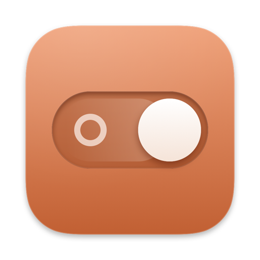
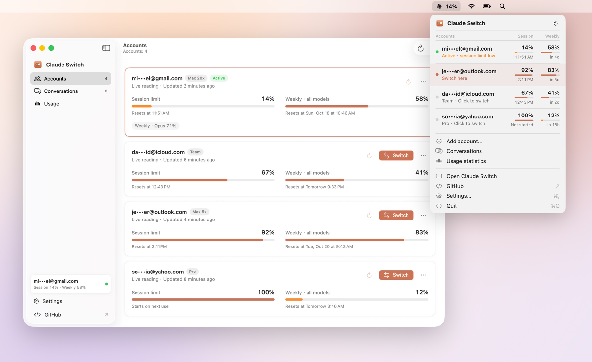
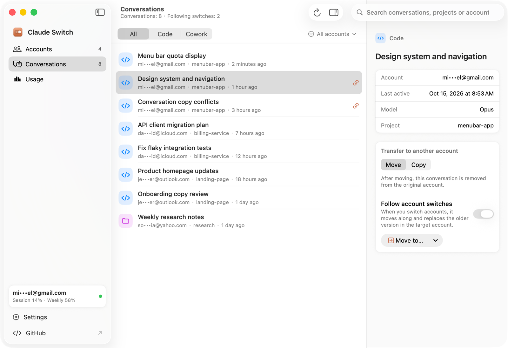
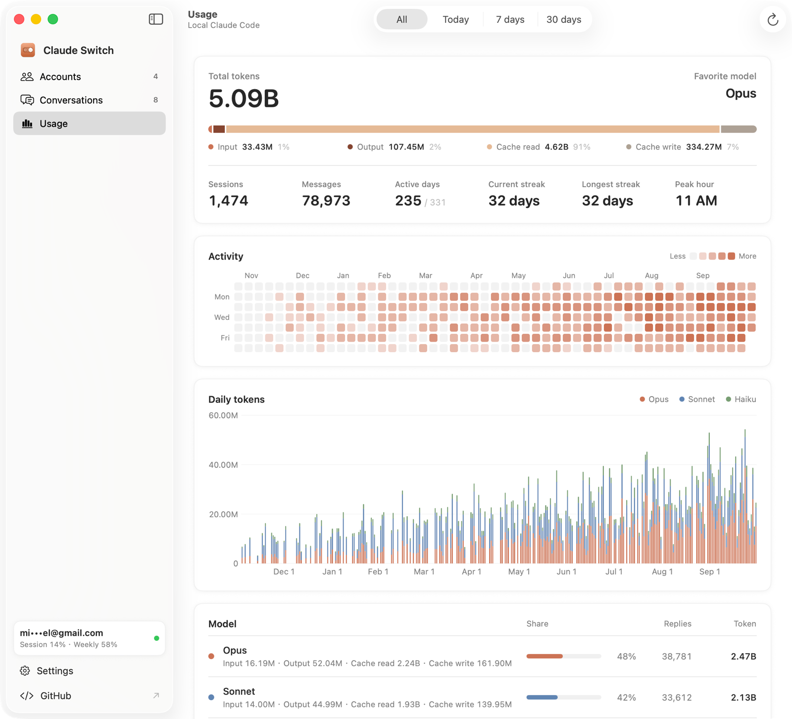

<div align="center">



# Claude Switch

**Every Claude Desktop account, one click away in your Mac's menu bar.**

Save each login once, switch between them in a second, and see every account's session and weekly limits at a glance.

[](https://github.com/uiuing/claude-desktop-switch/releases/latest)
[](https://github.com/uiuing/claude-desktop-switch/releases)


[](LICENSE)

**English** · [简体中文](README.zh-CN.md) · [繁體中文](README.zh-TW.md) · [日本語](README.ja.md)

<br>

<picture>
  <source media="(prefers-color-scheme: dark)" srcset="docs/images/hero-en-dark.jpg">
  
</picture>

</div>

## Why Claude Switch

Claude Desktop signs in to one account at a time. If you use a personal and a work account, or several plans for different projects, changing accounts means signing out, signing in again and losing track of how much quota each one has left.

Claude Switch keeps every login you use on your Mac, encrypted, and swaps them for you. It is a native macOS menu bar app with no third-party dependencies.

## Features

- **One-click switching.** Pick an account in the menu bar. Claude quits normally, the saved login is put back in place, and Claude reopens already signed in.
- **Limits at a glance.** Read session, weekly and model-specific limits and reset times directly from Claude online.
- **Automatic refresh.** The current account follows conversation activity; other accounts refresh every 30 minutes by default. Adjust intervals in Settings. Refresh pauses when Claude closes.
- **Smart suggestion.** When the current account is running low, the menu bar points to a saved account that still has room.
- **Add accounts without signing out.** "Add account" moves the current login aside so Claude opens at its sign-in screen. The previous account stays signed in on the server and keeps working.
- **Bring your Claude Code sessions along.** Move or copy local Claude Code sessions to another account, or let chosen sessions follow you whenever you switch.
- **Usage statistics.** Tokens, models, an activity heatmap, streaks and daily charts, counted the same way as Claude Desktop's own statistics.
- **Safe by design.** Encrypted snapshots, a strict allow-list of files, a journal that can roll back any interrupted switch, with network access limited to documented quota reads and configurable automatic refreshes. See [How it works](docs/how-it-works.md).
- **Feels at home on macOS.** SwiftUI, light and dark mode, keyboard shortcuts, and 10 languages.

## Screenshots

<table>
  <tr>
    <td width="50%">
      <picture>
        <source media="(prefers-color-scheme: dark)" srcset="docs/images/conversations-dark.png">
        
      </picture>
      <p align="center"><b>Conversations</b> · move, copy or follow sessions across accounts</p>
    </td>
    <td width="50%">
      <picture>
        <source media="(prefers-color-scheme: dark)" srcset="docs/images/usage-dark.png">
        
      </picture>
      <p align="center"><b>Usage</b> · tokens, models, heatmap and streaks</p>
    </td>
  </tr>
</table>

<sub>All screenshots use built-in sample data, rendered with <code>scripts/screenshots.sh</code>.</sub>

## Install

**Requirements:** macOS 14 Sonoma or later (Apple silicon or Intel) and [Claude Desktop](https://claude.ai/download).

1. Download `ClaudeSwitch-<version>-macOS.zip` from the [latest release](https://github.com/uiuing/claude-desktop-switch/releases/latest).
2. Unzip it and move **Claude Switch** to your Applications folder.
3. Open it. The app is not notarized by Apple yet, so the first launch needs one extra step:
   - macOS 15 and later: open **System Settings → Privacy & Security**, scroll down and click **Open Anyway**.
   - macOS 14: right-click the app, choose **Open**, then confirm.

   Or remove the download quarantine flag in Terminal:

   ```sh
   xattr -dr com.apple.quarantine "/Applications/Claude Switch.app"
   ```

Each release lists a SHA-256 checksum next to the download if you want to verify it.

### Updates

Claude Switch **doesn't have remote or automatic updates yet**. To hear about new versions, watch this repository (**Watch → Custom → Releases**) or check the [Releases](https://github.com/uiuing/claude-desktop-switch/releases) page, then replace the app in Applications. Your saved accounts stay on your Mac; macOS may ask once whether the new version may use Claude Switch's Keychain item. Choose **Always Allow**.

## Getting started

1. **Sign in to Claude Desktop** as usual, then open Claude Switch. The signed-in account is saved automatically.
2. **Add another account** with **Add account…** in the menu bar. Claude restarts at its sign-in screen; sign in with the other account and it is saved too.
3. **Switch** from the menu bar or the Accounts window whenever you like.

> [!IMPORTANT]
> To change accounts, use Claude Switch rather than Claude's **Log out** or Claude Code's `/login`.
> Signing out revokes that login on Anthropic's side, and the copy Claude Switch saved stops working.
> If Claude cannot restore the login, sign in once more and it is saved again.

Handy shortcuts in the main window: `⌘1` `⌘2` `⌘3` switch pages, `⌘K` searches accounts and sessions, `⌘R` refreshes the current account’s quota online.

## Privacy and security

- **Everything stays on your Mac.** Saved logins are encrypted with AES-256-GCM. The key lives in your login Keychain and is never synced to iCloud, so a copy of the saved logins alone can't be read.
- **No telemetry, no analytics, no servers of our own.**
- **Limited network access.** Only account and quota queries go to Anthropic. Automatic refresh can be disabled; local conversations are never uploaded.
- **A narrow footprint.** Only Claude Desktop's login files are swapped. Claude Code's own login, your projects, MCP servers, skills and settings are left alone.
- **Recoverable.** Every switch is journaled; if something interrupts it, Claude Switch can restore the previous state.

Details: [How it works](docs/how-it-works.md) · [Quota and usage data](docs/usage-data.md) · [Security policy](.github/SECURITY.md)

## FAQ

<details>
<summary><b>Why does macOS ask to let Claude Switch use "Claude Safe Storage"?</b></summary>

Claude encrypts its login tokens with a key stored in that Keychain item. Claude Switch only needs it to read the selected account's current limits online, and only asks when you press refresh yourself. Choose **Always Allow** to avoid repeated prompts. Everything else works without it.
</details>

<details>
<summary><b>Does it switch the Claude Code CLI too?</b></summary>

No. Claude Switch switches Claude Desktop. The Claude Code command-line tool keeps its own separate login.
</details>

<details>
<summary><b>Why do some accounts show "—" or an older reading?</b></summary>

A failed refresh keeps the last successful reading and its timestamp; “—” means no reading is available yet. If the saved access token has expired, switch to that account and let Claude update its login.
</details>

<details>
<summary><b>Can I move my saved accounts to another Mac?</b></summary>

Not by copying files: the saved logins can only be read with the key in this Mac's login Keychain. Migration Assistant, or restoring a backup of your whole user account, brings that Keychain along, so saved accounts may keep working. Otherwise, sign in to each account once on the new Mac and it is saved again.
</details>

<details>
<summary><b>Will a Claude Desktop update break it?</b></summary>

Claude Switch relies on Claude Desktop's local file formats, which are not a public API. When it meets a format it does not recognize, it stops instead of guessing, and nothing is changed. Please [open an issue](https://github.com/uiuing/claude-desktop-switch/issues/new/choose) if that happens.
</details>

## Build from source

You need Xcode 16 or later (Swift 6 toolchain).

```sh
git clone https://github.com/uiuing/claude-desktop-switch.git
cd claude-desktop-switch
swift test                               # unit tests
zsh scripts/build.sh                     # builds "dist/Claude Switch.app"
open "dist/Claude Switch.app" --args --demo   # try it with sample data
```

`scripts/build.sh --read-only` builds a version that can show everything but never changes Claude's files. See [Architecture](docs/architecture.md) and [Contributing](.github/CONTRIBUTING.md) for more.

## Languages

English, 简体中文, 繁體中文, 日本語, 한국어, Español, Français, Deutsch, Português (Brasil) and Русский. The app follows your macOS language and can be changed in Settings. Translation fixes are very welcome.

## Contributing

Bug reports, ideas and pull requests are welcome. Please read [CONTRIBUTING](.github/CONTRIBUTING.md) first, and report security issues privately as described in the [security policy](.github/SECURITY.md).

Working with Claude Code or another AI assistant? [AGENTS.md](AGENTS.md) and [CLAUDE.md](CLAUDE.md) give it the project's rules, commands and slash commands, and [docs/claude-internals.md](docs/claude-internals.md) documents the Claude Desktop and Claude Code formats this app depends on.

## License

[MIT](LICENSE)

Claude Switch is an independent open-source project. It is not affiliated with, endorsed by or sponsored by Anthropic. Claude and Claude Desktop are trademarks of Anthropic, PBC. Use it only with accounts you are allowed to use, and in line with Anthropic's terms.
