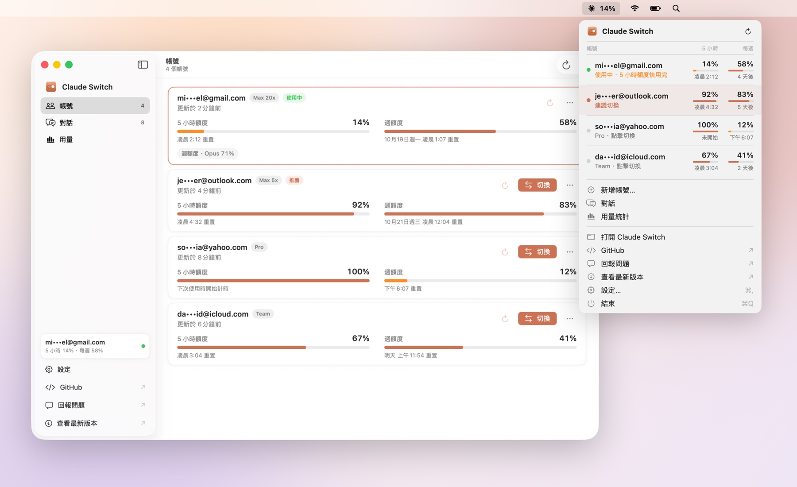
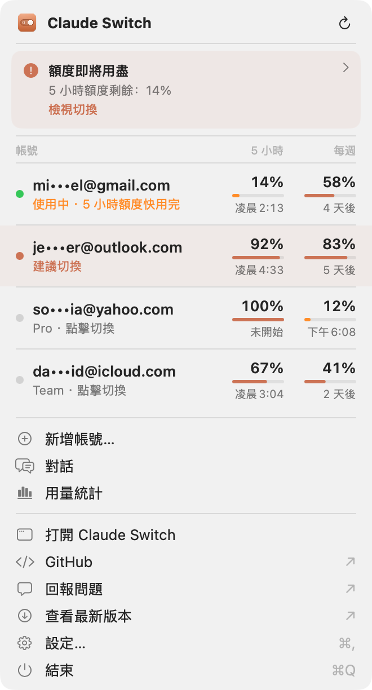
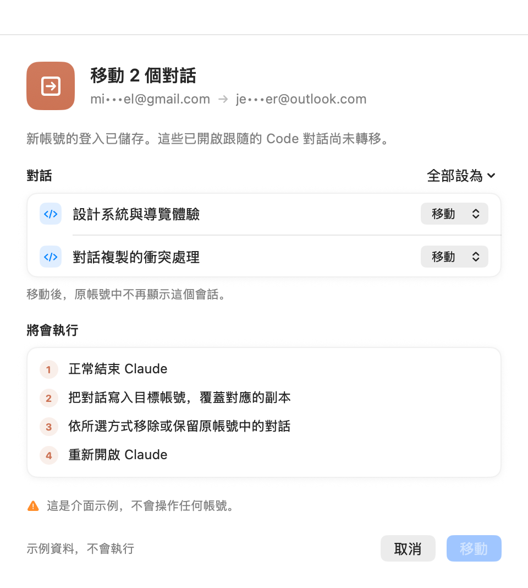

<div align="center">


# Claude Switch

**在 Mac 選單列管理所有 Claude Desktop 帳號，一鍵切換。**

保存登入、查看剩餘額度，切換帳號時也能帶上本機 Code 對話。

[](https://github.com/uiuing/claude-desktop-switch/releases/latest)
[](https://github.com/uiuing/claude-desktop-switch/releases)


[](LICENSE)

[English](README.md) · [简体中文](README.zh-CN.md) · **繁體中文** · [日本語](README.ja.md)

<br>

<picture>
  <source media="(prefers-color-scheme: dark)" srcset="docs/images/hero-zh-Hant-dark.jpg">
  
</picture>

</div>

## 為什麼需要它

Claude Desktop 同一時間只能登入一個帳號。如果你同時有個人帳號和工作帳號，或不同專案使用不同方案，換帳號就得登出、再登入，也很難記住每個帳號還剩多少額度。

Claude Switch 會把你用到的每個登入加密保存在本機，並替你完成切換。它是原生 macOS 選單列 App，沒有第三方相依套件。

## 功能

- **切換不必重新登入**：選擇已保存的帳號並確認，Claude 會正常結束、還原登入，再自動開啟。
- **剩餘額度一目瞭然**：從線上取得 5 小時、每週與模型專屬額度，同時顯示重置時間及上次更新時間。自動更新會配合對話活動調整，Claude 結束後暫停。
- **找到還有餘裕的帳號**：依方案、剩餘額度與已確認的重置時間排序，目前帳號固定置頂；過期資料不會觸發推薦。
- **需要時提醒你**：選單列標記與選用的 macOS 通知提示推薦帳號，確認切換前可先檢視帳號和跟隨的對話。
- **Code 對話跟著走**：移動、複製或跟隨本機 Claude Code 對話，保留模式、工作樹與偏好設定。新增帳號後，也能在獨立的預覽中確認帶入跟隨對話。
- **新增帳號不必登出**：保留原帳號的登入，讓 Claude 開啟登入頁；新帳號登入完成後會自動保存。
- **查看本機用量**：Token 總量、模型、活躍熱度圖、連續天數與每日圖表；用量統計與訂閱額度分開呈現。
- **資料由你掌握**：登入在本機加密保存，切換與轉移都有可回復的操作日誌。沒有自建伺服器接收帳號或對話資料。詳見 [運作原理](docs/how-it-works.md)（英文）。
- **原生 macOS 體驗**：SwiftUI、淺色與深色模式、快速鍵、10 種語言，並內建版本檢查，下載與安裝由你決定。

## 截圖

<table>
  <tr>
    <td width="50%">
      <picture>
        <source media="(prefers-color-scheme: dark)" srcset="docs/images/conversations-dark.png">
        
      </picture>
      <p align="center"><b>對話</b> · 在帳號之間移動、複製或跟隨工作階段</p>
    </td>
    <td width="50%">
      <picture>
        <source media="(prefers-color-scheme: dark)" srcset="docs/images/usage-dark.png">
        
      </picture>
      <p align="center"><b>用量</b> · Token、模型、熱度圖與連續天數</p>
    </td>
  </tr>
  <tr>
    <td width="50%">
      
      <p><b>切換提醒</b> · 先查看推薦帳號的額度，再確認切換</p>
    </td>
    <td width="50%">
      
      <p><b>帶上對話</b> · 新增帳號後確認移動或複製</p>
    </td>
  </tr>
</table>

<sub>所有截圖皆使用內建範例資料，由 <code>scripts/screenshots.sh</code> 產生。</sub>

## 安裝

**系統需求**：macOS 14 Sonoma 或更新版本（Apple 晶片或 Intel 皆可），並已安裝 [Claude Desktop](https://claude.ai/download)。

1. 從 [最新版本](https://github.com/uiuing/claude-desktop-switch/releases/latest) 下載 `ClaudeSwitch-<版本>-macOS.zip`。
2. 解壓縮後把 **Claude Switch** 拖到「應用程式」資料夾。
3. 開啟它。App 尚未經過 Apple 公證，第一次開啟需要多一個步驟：
   - macOS 15 及以上：開啟 **系統設定 → 隱私權與安全性**，往下捲動，按 **強制打開**。
   - macOS 14：在 App 上按右鍵，選 **打開**，再確認一次。

   也可以在終端機移除下載隔離標記：

   ```sh
   xattr -dr com.apple.quarantine "/Applications/Claude Switch.app"
   ```

每個版本的下載旁都附有 SHA-256 檢查碼，可用來核對檔案。

### 更新

Claude Switch 執行時每天最多檢查一次 GitHub 新版本。可在 **設定 → 版本更新** 中手動檢查或關閉自動檢查。**查看最新版本** 會開啟 [發布頁](https://github.com/uiuing/claude-desktop-switch/releases/latest)，下載與安裝由你手動完成。

取代「應用程式」中的舊版前，請先結束 Claude Switch。啟動時若顯示授權頁面，按 **允許存取**，再於 macOS 對話框中允許存取 **Claude Safe Storage** 與 **Claude Switch · 已儲存的登入**。選擇 **永遠允許**，可記住對目前 App 版本的授權。

## 快速上手

1. 像平常一樣**登入 Claude Desktop**，然後開啟 Claude Switch，依提示允許存取鑰匙圈，目前的帳號會自動保存。
2. 在選單列按 **新增帳號…**。Claude 會重新啟動到登入頁，用另一個帳號登入，它也會自動保存。
3. 之後隨時在選單列或帳號視窗中**切換**。


可在首次設定或 **設定 → 通知** 啟用切換推薦及操作結果通知。每次切換仍需你確認。

> [!IMPORTANT]
> 換帳號請使用 Claude Switch，不要用 Claude 裡的 **登出** 或 Claude Code 的 `/login`。
> 登出會讓這個登入在 Anthropic 那端失效，Claude Switch 保存的副本也就無法使用。
> 如果 Claude 無法恢復登入，在 Claude 裡重新登入一次即可再次保存。

主視窗快速鍵：`⌘1` `⌘2` `⌘3` 切換頁面，`⌘K` 搜尋帳號與對話，`⌘R` 更新本機帳號與對話；額度使用各帳號卡片上的更新按鈕。

## 隱私與安全

- **資料只留在你的 Mac**：保存的登入以 AES-256-GCM 加密，金鑰存放在登入鑰匙圈中，不會同步到 iCloud，單獨複製保存的登入也無法讀取。
- **沒有遙測、沒有統計、沒有我們自己的伺服器。**
- **有限的連網行為**：向 Anthropic 查詢帳號與額度，向 GitHub 查詢公開版本資訊，兩項自動檢查均可關閉。版本檢查不傳送帳號資料，也不上傳本機對話。
- **影響範圍很小**：只替換 Claude Desktop 的登入檔案；Claude Code 本身的登入、你的專案、MCP 伺服器、Skills 與設定都不會動到。
- **可以回復**：每次切換都有操作日誌，中途被打斷時可以回復到切換前的狀態。

詳細說明（英文）：[運作原理](docs/how-it-works.md) · [額度與用量資料](docs/usage-data.md) · [安全政策](.github/SECURITY.md)

## 常見問題

<details>
<summary><b>為什麼 macOS 會詢問是否允許 Claude Switch 使用「Claude Safe Storage」？</b></summary>

Claude 用這個鑰匙圈項目中的金鑰加密登入權杖。Claude Switch 只有在線上讀取所選帳號的額度時才需要它，只在你按 **允許存取** 或手動更新額度時詢問。一次授權供所有帳號使用，受影響的帳號會自動重試。啟動時會先檢查權限，授權後才能進入。選 **永遠允許** 可避免重新啟動後重複詢問。
</details>

<details>
<summary><b>會一起切換 Claude Code 命令列嗎？</b></summary>

不會。Claude Switch 切換的是 Claude Desktop；Claude Code 命令列工具有自己獨立的登入。
</details>

<details>
<summary><b>為什麼有些帳號顯示「—」或較早的額度資料？</b></summary>

更新失敗時保留上次成功的額度資料與時間；「—」表示尚無可用額度資料。若保存的存取權杖已過期，請切換到該帳號，讓 Claude 更新登入憑證。
</details>

<details>
<summary><b>可以把保存的帳號搬到另一台 Mac 嗎？</b></summary>

單獨複製檔案不行：保存的登入只能用這台 Mac 登入鑰匙圈裡的金鑰讀取。用移轉輔助程式或從備份完整還原使用者帳號時，鑰匙圈會一起移轉，保存的帳號可能可以繼續使用。否則在新的 Mac 上把每個帳號登入一次，就會重新保存。
</details>

<details>
<summary><b>Claude Desktop 更新後會不會失效？</b></summary>

Claude Switch 依賴 Claude Desktop 的本機檔案格式，這並非公開 API。遇到無法辨識的格式時，它會停下來而不是猜測，也不會改動任何東西。若遇到這種情況，歡迎 [回報 Issue](https://github.com/uiuing/claude-desktop-switch/issues/new/choose)。
</details>

## 從原始碼建置

需要 Xcode 16 或更新版本（Swift 6 工具鏈）。

```sh
git clone https://github.com/uiuing/claude-desktop-switch.git
cd claude-desktop-switch
swift test                               # 單元測試
zsh scripts/build.sh                     # 產生 "dist/Claude Switch.app"
open "dist/Claude Switch.app" --args --demo   # 用範例資料試用
```

`scripts/build.sh --read-only` 會建置一個只能檢視、永遠不會改動 Claude 檔案的版本。更多內容請見 [架構說明](docs/architecture.md) 與 [貢獻指南](.github/CONTRIBUTING.md)（英文）。

## 介面語言

English、简体中文、繁體中文、日本語、한국어、Español、Français、Deutsch、Português (Brasil)、Русский。預設跟隨 macOS 語言，也可以在設定中更改。歡迎協助改進翻譯。

## 參與貢獻

歡迎回報 Bug、提出建議與送出 Pull Request。送出前請先閱讀 [貢獻指南](.github/CONTRIBUTING.md)；安全問題請依 [安全政策](.github/SECURITY.md) 私下回報。

如果你使用 Claude Code 或其他 AI 程式設計助手開發：[AGENTS.md](AGENTS.md) 與 [CLAUDE.md](CLAUDE.md) 提供專案規則、常用指令與斜線指令，[docs/claude-internals.md](docs/claude-internals.md) 記錄了本專案依賴的 Claude Desktop 與 Claude Code 本機資料格式（英文）。

## 授權

[MIT](LICENSE)

Claude Switch 是獨立的開源專案，與 Anthropic 沒有任何隸屬、背書或贊助關係。Claude 與 Claude Desktop 是 Anthropic, PBC 的商標。請只在你有權使用的帳號上使用，並遵守 Anthropic 的相關條款。
