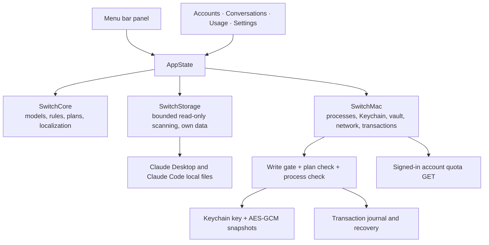

# Architecture

Claude Switch is a Swift package with no third-party dependencies. It uses SwiftUI and AppKit for the interface and Foundation, Security, CryptoKit and CommonCrypto underneath. The app targets macOS 14 and later.

The Claude Desktop and Claude Code formats it reads are described in [claude-internals.md](claude-internals.md); conventions for contributors and AI assistants are in [AGENTS.md](../AGENTS.md).

## Modules



| Target | Responsibility |
| --- | --- |
| `SwitchCore` | Foundation-only models, quota presentation and reset inference, session sorting and follow rules, operation plans, localization catalogs |
| `SwitchStorage` | Safe, bounded reading of Claude's files (`LocalReader`, `DesktopProfile`, `TokenScanner`, `LimitLogScanner`, `LoginProbe`) and storage of the app's own library |
| `SwitchMac` | macOS adapters: Claude process control, the credential vault, the online quota client, file transactions, session transfer and the `SwitchEngine` that ties them together |
| `ClaudeSwitch` | The SwiftUI app: menu bar extra, main window, sheets and `AppState` |
| `SwitchInspect` | `switch-inspect`, a read-only diagnostic that prints counts only |

The interface only reflects state and starts explicit user actions. Rules that decide what is safe to do live in `SwitchCore` and `SwitchMac`, so the UI is never the only safeguard.

## The write gate

Every action that changes Claude's files or processes (quitting or opening Claude, replacing the login, moving or copying sessions, recovering a transaction) first calls `BuildAccess.requireClaudeWrites()`. It is controlled by the `CLAUDE_WRITE_ENABLED` compilation condition:

- `scripts/build.sh` builds the normal app with writes enabled.
- `scripts/build.sh --read-only` builds an app that can inspect everything and preview operations, but cannot execute them.
- `swift build` and `swift test` without flags are read-only too. Tests that exercise write paths only run with `-Xswiftc -DCLAUDE_WRITE_ENABLED`, and they use temporary fixtures inside `.build/`.

Saving the signed-in login is not gated: it only reads Claude's files and writes to the app's own vault.

## Data flow

1. `AppState.start()` loads `library.json`, starts the usage scan in the background and runs `refresh()`.
2. `refresh()` scans Claude's local files through `LocalReader`, merges new quota samples, rolls quota windows past their reset times and saves the signed-in login if it changed. It runs every 60 seconds.
3. User actions call `SwitchEngine.prepare(...)`, which returns an `OperationPlan`. The confirmation sheet shows the plan; `execute(...)` re-validates it and runs it as a `FileTransaction`.
4. Online quota reads go through `ActiveUsageClient` only on the triggers described in [usage-data.md](usage-data.md).

## Localization

All user-facing text goes through `L10n.tr("Key", arguments...)`. Catalogs are JSON files in `Sources/SwitchCore/Localizations/`, one per language: English, Simplified Chinese, Traditional Chinese, Japanese, Korean, Spanish, French, German, Brazilian Portuguese and Russian.

- Placeholders are indexed (`{0}`, `{1}`) so translations can reorder them. Substitution is a single pass, so user content containing braces stays literal.
- The language follows macOS by default and can be changed in Settings without restarting.
- `LocalizationTests` checks that every catalog has the same keys and the same placeholders.

Account emails, session titles and other user data are never translated.

## Demo mode

Launching the app with `--demo` replaces all data with built-in sample accounts, sessions and statistics. In demo mode the app does not read Claude's files, touch the Keychain or use the network, and it does not save its library, which makes it safe for UI work and screenshots:

```sh
zsh scripts/build.sh --read-only
open "dist/Claude Switch.app" --args --demo
```

## Diagnostics

`switch-inspect` reads the same local files as the app and prints counts as JSON: whether a signed-in identity was found, the number of local accounts, quota slots and Claude Code records. It never prints emails, account IDs, titles or tokens, never touches the Keychain or the network, and never writes anything.

```sh
swift run switch-inspect            # inventory counts
swift run switch-inspect --tokens   # also scan the last 30 days of token usage
```

## Platform

Only macOS is supported. The core rules and data contracts in `SwitchCore` are platform-neutral, but storage access, credential protection and process control are macOS-specific, and saved logins are bound to the Mac they were created on.
