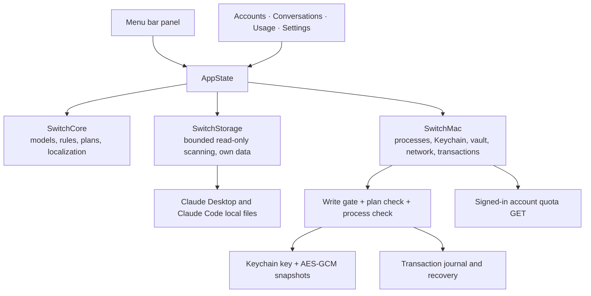

# Architecture

Claude Switch is a Swift package with no third-party dependencies. It uses SwiftUI and AppKit for the interface and Foundation, Security, CryptoKit and CommonCrypto underneath. The app targets macOS 14 and later.

The Claude Desktop and Claude Code formats it reads are described in [claude-internals.md](claude-internals.md); conventions for contributors and AI assistants are in [AGENTS.md](../AGENTS.md).

## Modules



| Target | Responsibility |
| --- | --- |
| `SwitchCore` | Foundation-only models, quota presentation and reset inference, shared account ranking and switch advice, session sorting and follow rules, operation plans, localization catalogs |
| `SwitchStorage` | Safe, bounded reading of Claude's files (`LocalReader`, `DesktopProfile`, `TokenScanner`, `LimitLogScanner`, `LoginProbe`) and storage of the app's own library |
| `SwitchMac` | macOS adapters: Claude process control, the credential vault, the online quota client, file transactions, session transfer and the `SwitchEngine` that ties them together |
| `ClaudeSwitch` | The SwiftUI app: menu bar extra, main window, sheets and `AppState` |
| `SwitchInspect` | `switch-inspect`, a read-only diagnostic that prints counts only |

The interface only reflects state and starts explicit user actions. Rules that decide what is safe to do live in `SwitchCore` and `SwitchMac`, so the UI is never the only safeguard.

`SessionTransferRecord` removes explicit account authorization/cloud binding containers and live connection fields, plus the verified pending-start and task-suggestion binding paths. It distinguishes local dispatch lineage and task suggestions from their cloud counterparts; it does not scan arbitrary text for keywords or interpret every metadata field. `MigrationBuilder` uses Foundation JSON serialization to retain nested values and integer precision, validates source and target identity during preview and after shutdown, and keeps the existing path, transcript and fingerprint checks. `SessionLibrary` gives the current account's copy priority and prevents unrelated fallback copies from overwriting an existing target. Activity and file timestamps do not decide whether a selected source may replace the target. The [session transfer field policy](session-fields.md) defines the preservation and exclusion rules.

The workbench's minimum size belongs to its `NSWindow`. The split-view detail accepts a zero minimum width so page content can shrink while the conversation inspector closes, preserving the user's window width during navigation.

Prominent action buttons retain their native button behavior and add a hover overlay; sidebar and conversation rows add a rounded hover background while keeping native list selection and keyboard navigation. Borderless actions, custom menu rows and clickable cards share similar hover and press emphasis. Custom highlights respect Increase Contrast and Reduce Motion, and disabled controls do not highlight.

## The write gate

Every action that changes Claude's files or processes (quitting or opening Claude, replacing the login, moving or copying sessions, recovering a transaction) first calls `BuildAccess.requireClaudeWrites()`. It is controlled by the `CLAUDE_WRITE_ENABLED` compilation condition:

- `scripts/build.sh` builds the normal app with writes enabled.
- `scripts/build.sh --read-only` builds an app that can inspect everything and preview operations, but cannot execute them.
- `swift build` and `swift test` without flags are read-only too. Tests that exercise write paths only run with `-Xswiftc -DCLAUDE_WRITE_ENABLED`, and they use temporary fixtures inside `.build/`.

Saving the signed-in login does not require `BuildAccess`: it only reads Claude's files and writes to the app's own vault. It still waits for startup authorization.

## Data flow

1. `AppState.start()` silently checks both Claude Safe Storage and the local-vault key through `StartupAccess`, tracking the results separately. Notification onboarding is shown with its default-on choice when no prior notification choice exists, even when both keys are already available; explicit continuation requests notification access, and denial does not block account features. Missing permission blocks the workbench, menu and action shortcuts until explicit authorization succeeds. Only then are `library.json`, background scans, vault maintenance and `refresh()` started, once across both scenes. The check does not read tokens or contact quota endpoints.
2. `refresh()` scans Claude's local files through `LocalReader`, marks elapsed reset times as awaiting confirmation and saves the signed-in login if it changed. A 60-second heartbeat checks whether Claude is running; local rescans and task-record metadata sampling pause when it is closed. While adding an account, login publication metadata is checked every second, with a local scan at least every five seconds; discovery slows after fifteen minutes and continues until the login is saved. After switching, a separate three-second check watches whether Claude stays signed in. Usage statistics are rescanned every minute while the Usage page is on screen, otherwise every ten minutes.
   `AppState` is `@Observable`, so a view redraws only for what it reads: a statistics scan does not redraw the menu bar.
3. User actions call `SwitchEngine.prepare(...)`, which returns an `OperationPlan`. The confirmation sheet shows the plan; `execute(...)` re-validates it and runs it as a `FileTransaction`.
4. General refresh controls update local inventory without enqueueing quota work. Both quota and vault keys use separate `KeychainKeyCache` instances, with all system queries serialized by `KeychainInteraction`. They are cleared on sleep, session deactivation and exit, then silently rechecked on wake; access recovery unblocks only permission failures. Key rechecks preserve the existing key until a replacement is read, coalesce concurrent attempts, and reject results from before a lifecycle clear. A bounded set of credential fingerprints prevents malformed snapshots from repeatedly rechecking an unchanged key. A replacement-read denial stays scoped to its account when a shared key remains available; manual refresh retains permission to request authorization. Online quota reads go through `ActiveUsageClient` only on the triggers described in [usage-data.md](usage-data.md). Manual reads target the selected account. `QuotaRefreshSchedule` determines due accounts from online timestamps and recent task-record changes. `SessionActivityReader` reads metadata only, bounded to current-account records. `QuotaRefreshQueue` serializes and staggers automatic reads for both sides of a successful or observed switch, coalesces duplicate discovery notifications and defers individual accounts during cooldowns without blocking the other account. The queue pauses during file operations, local scans, manual reads, sleep, offline periods and while Claude is closed. Settings control automatic polling and its intervals. The active login comes from Desktop, other saved logins from `CredentialVault`; automatic reads never request a Keychain prompt. Both use the same token parser, verify the profile identity and revalidate credentials before accepting a reading. Account/organization cooldowns and actual-token denials use separate persisted keys. A file observer detects same-account credential publication with a 60-second scan fallback; stale/recovery reads can also be triggered by startup, wake or network restoration. Profile validation has an in-memory cache scoped to the account, organization and token until expiry. Profile GETs occur only on first token verification, both sides of a switch, and manual account-card refresh. Stable switch refresh IDs survive queue coalescing and retries, so successful profile reads are not repeated just to retry usage. Only fresh profile responses publish account metadata; online-confirmed email and plan information outranks local caches. Existing scans update unconfirmed Desktop information and use Code or saved snapshots only to fill gaps. No profile timer is added.

`AccountRanking.evaluate` is a pure evaluation of saved account metadata and attributed online quota rows. It returns the underlying ranking, the separately pinned display order, the best usable backup and optional `SwitchAdvice`. `AppState.accounts` and historical account selectors consume that order; `MenuPanel` does not promote a separately selected suggestion. A menu-local `AccountMenuSnapshot` freezes IDs for an open panel while allowing invalid suggestions to disappear. Ranking never starts I/O or learns capacity from token statistics. Policy details and limits are documented in [usage-data.md](usage-data.md#account-order-and-switch-suggestions).

Conversation search resolves displayed account names once per query and reuses the filtered list for rows, groups and the subtitle. Follow counts use sets of session IDs and legacy conversation IDs, deduplicating copies across accounts without searching the inventory again for each row. Both are computed from current state, so account updates, masking preferences, filters and follow changes apply immediately.

`SwitchReminderPolicy` stores bounded, Codable receipts for recommendation episodes independently of UI visibility or notification permission. Episodes match account, organization and quota window while their reset is still ahead of the online observation. Reset corrections, including shifts of up to one minute across the old boundary, retain the reminder UUID and reviewed state; missing reset times preserve the last known boundary. A fresh reading past that boundary with a later reset starts a new cycle. Exhaustion has one escalation UUID that survives small rebounds. Without a reset timestamp, fresh recovery more than five percentage points above the warning threshold rearms the reminder. `AppState` reevaluates it after existing inventory/quota updates and at the next freshness deadline; reminder evaluation adds no polling timer or network trigger. `OperationFeedback` formats structured execution outcomes as account and conversation results, preserving manual-open and recovery-backup warnings. It uses the selected account display preference and existing fresh online quota rows without adding network requests. `AppNotifications` owns the local `UNUserNotificationCenter` delegate, explicit authorization, category actions and removal of withdrawn notices. Recommendation payloads contain an opaque reminder UUID only; result notifications display the selected account and available quota, while raw failure details stay in the app. Routing resolves that UUID against the current recommendation, prepares an ordinary `PendingOperation`, and never calls execution. Demo mode and unbundled test executables cannot register or send system notifications. The platform API follows Apple's [notification authorization](https://developer.apple.com/documentation/usernotifications/unusernotificationcenter/requestauthorization(options:completionhandler:)) and [notification delegate](https://developer.apple.com/documentation/usernotifications/unusernotificationcenterdelegate) contracts.

## Localization

All user-facing text goes through `L10n.tr("Key", arguments...)`. Catalogs are JSON files in `Sources/SwitchCore/Localizations/`, one per language: English, Simplified Chinese, Traditional Chinese, Japanese, Korean, Spanish, French, German, Brazilian Portuguese and Russian.

- Placeholders are indexed (`{0}`, `{1}`) so translations can reorder them. Substitution is a single pass, so user content containing braces stays literal.
- The language follows macOS by default and can be changed in Settings without restarting.
- `LocalizationTests` checks that every catalog has the same keys and the same placeholders.

Account emails, session titles and other user data are never translated.

## Public release checks

`ProjectLink` owns the repository, Issues and latest-release URLs. `GitHubReleaseClient` makes an unauthenticated HEAD request to the public latest-release page with an ephemeral URLSession, no cookie or credential storage, and bounded timeouts. It reads only the redirect header, checks that the destination is this exact project’s HTTPS release-tag page, and does not follow it or download a body. This avoids depending on the GitHub API quota. `ReleaseVersion` compares stable tags numerically; prerelease and unknown tags do not produce update prompts.

`AppUpdates` coalesces requests across scenes, persists the daily automatic-check interval and endpoint-specific GitHub cooldowns, and distinguishes new, current, failed and unknown-version results. It does not depend on account services. `UpdateSettingsView` exposes the automatic-check choice and manual check; sidebar, menu and Help links use `/releases/latest` rather than a fixed tag. Demo mode never starts checks, and tests inject their fetch closure and preference store.

## Demo mode

Launching the app with `--demo` replaces all data with built-in sample accounts, sessions and statistics. Demo mode bypasses the authorization gate. In demo mode the app does not read Claude's files, touch the Keychain or use the network, and it does not save its library, which makes it safe for UI work and screenshots:

```sh
zsh scripts/build.sh --read-only
open "dist/Claude Switch.app" --args --demo
```

## Diagnostics

`switch-inspect` reads the same local files as the app and prints counts as JSON: whether a signed-in identity was found, the number of local accounts, quota slots and Claude Code records. It never prints emails, account IDs, titles or tokens, never touches the Keychain or the network, and never writes anything.

```sh
swift run switch-inspect            # inventory counts
swift run switch-inspect --tokens   # also scan the last 30 days of token usage
```

## Platform

Only macOS is supported. The core rules and data contracts in `SwitchCore` are platform-neutral, but storage access, credential protection and process control are macOS-specific, and saved logins are bound to the Mac they were created on.

## P1–P3 quota recovery implementation

| Priority | Changes | Fixture coverage |
| --- | --- | --- |
| P1 | Same-account token renewal, late publication recovery, current account priority | `QuotaRefreshQueueTests`, `UsageClientTests` |
| P1 | Stable cookie database plus WAL copy; local absence does not imply revocation | `LoginProbeTests` |
| P1 | Exact client/audience/scopes/account matching; separate storage, token and rate-budget keys | `DesktopTokenTests`, `UsageClientTests` |
| P1 | Full persisted Retry-After, limited compatibility request builder | `UsageClientTests` |
| P2 | Immutable measurements, pending resets, per-window provenance, stale suggestions excluded | `QuotaResetTests` |
| P2 | Typed credential/HTTP/transport errors, bounded retries and cancellation | `DesktopTokenTests`, `UsageClientTests` |
| P2 | Published config consistency; identity-changing or torn journals wait for publication | `ConfigJournalTests` |
| P3 | Debounced filesystem observer, wake/network triggers and local polling fallback | Observer wiring; queue/client fixtures; live OS events require manual acceptance |
| P3 | Bounded profile cache, visible recovery state and strict window parsing | `UsageClientTests`, `UsageResponseParserTests`, demo screenshot renderer |

Real-account refresh, real Keychain approval, actual Desktop renewal and operating-system wake/network events are not simulated as live acceptance by the fixture suite. No credential refresh endpoint is implemented. Protocol compatibility is documented in [usage-data.md](usage-data.md).
