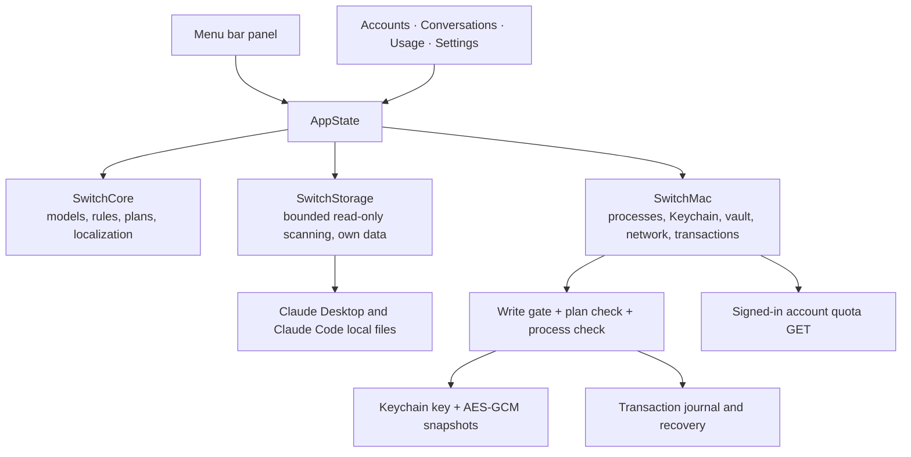

# Architecture

Claude Switch is a Swift package with no third-party dependencies. It uses SwiftUI and AppKit for the interface and Foundation, Security, CryptoKit and CommonCrypto underneath. The app targets macOS 14 and later.

The Claude Desktop and Claude Code formats it reads are described in [claude-internals.md](claude-internals.md); conventions for contributors and AI assistants are in [AGENTS.md](../AGENTS.md).

## Modules



| Target | Responsibility |
| --- | --- |
| `SwitchCore` | Foundation-only models, quota presentation and reset inference, session sorting and follow rules, operation plans, localization catalogs |
| `SwitchStorage` | Safe, bounded reading of Claude's files (`LocalReader`, `DesktopProfile`, `TokenScanner`, `LimitLogScanner`, `LoginProbe`) and storage of the app's own library |
| `SwitchMac` | macOS adapters: Claude process control, the credential vault, the online quota client, file transactions, session transfer and the `SwitchEngine` that ties them together |
| `ClaudeSwitch` | The SwiftUI app: menu bar extra, main window, sheets and `AppState` |
| `SwitchInspect` | `switch-inspect`, a read-only diagnostic that prints counts only |

The interface only reflects state and starts explicit user actions. Rules that decide what is safe to do live in `SwitchCore` and `SwitchMac`, so the UI is never the only safeguard.

## The write gate

Every action that changes Claude's files or processes (quitting or opening Claude, replacing the login, moving or copying sessions, recovering a transaction) first calls `BuildAccess.requireClaudeWrites()`. It is controlled by the `CLAUDE_WRITE_ENABLED` compilation condition:

- `scripts/build.sh` builds the normal app with writes enabled.
- `scripts/build.sh --read-only` builds an app that can inspect everything and preview operations, but cannot execute them.
- `swift build` and `swift test` without flags are read-only too. Tests that exercise write paths only run with `-Xswiftc -DCLAUDE_WRITE_ENABLED`, and they use temporary fixtures inside `.build/`.

Saving the signed-in login is not gated: it only reads Claude's files and writes to the app's own vault.

## Data flow

1. `AppState.start()` loads `library.json`, starts the usage scan in the background and runs `refresh()`.
2. `refresh()` scans Claude's local files through `LocalReader`, marks elapsed reset times as awaiting confirmation and saves the signed-in login if it changed. A 60-second heartbeat checks whether Claude is running; local rescans and task-record metadata sampling pause when it is closed. While Claude shows its sign-in screen, or right after a switch, only the signed-in account, its credentials and the session cookie are checked every three seconds, and a change triggers `refresh()`. Usage statistics are rescanned every minute while the Usage page is on screen, otherwise every ten minutes.
   `AppState` is `@Observable`, so a view redraws only for what it reads: a statistics scan does not redraw the menu bar.
3. User actions call `SwitchEngine.prepare(...)`, which returns an `OperationPlan`. The confirmation sheet shows the plan; `execute(...)` re-validates it and runs it as a `FileTransaction`.
4. General refresh controls update local inventory without enqueueing quota work. Shared Keychain authorization is held in memory by `QuotaKeyAccess` and cleared on sleep, session deactivation and exit; access recovery unblocks only permission failures. Online quota reads go through `ActiveUsageClient` only on the triggers described in [usage-data.md](usage-data.md). Manual reads target the selected account. `QuotaRefreshSchedule` determines due accounts from online timestamps and recent task-record changes. `SessionActivityReader` reads metadata only, bounded to current-account records. `QuotaRefreshQueue` serializes and staggers automatic reads for both sides of a successful or observed switch, coalesces duplicate discovery notifications and defers individual accounts during cooldowns without blocking the other account. The queue pauses during file operations, local scans, manual reads, sleep, offline periods and while Claude is closed. Settings control automatic polling and its intervals. The active login comes from Desktop, other saved logins from `CredentialVault`; automatic reads never request a Keychain prompt. Both use the same token parser, verify the profile identity and revalidate credentials before accepting a reading. Account/organization cooldowns and actual-token denials use separate persisted keys. A file observer detects same-account credential publication with a 60-second scan fallback; stale/recovery reads can also be triggered by startup, wake or network restoration. Profile validation has a ten-minute in-memory cache scoped to the account, organization and token.

## Localization

All user-facing text goes through `L10n.tr("Key", arguments...)`. Catalogs are JSON files in `Sources/SwitchCore/Localizations/`, one per language: English, Simplified Chinese, Traditional Chinese, Japanese, Korean, Spanish, French, German, Brazilian Portuguese and Russian.

- Placeholders are indexed (`{0}`, `{1}`) so translations can reorder them. Substitution is a single pass, so user content containing braces stays literal.
- The language follows macOS by default and can be changed in Settings without restarting.
- `LocalizationTests` checks that every catalog has the same keys and the same placeholders.

Account emails, session titles and other user data are never translated.

## Demo mode

Launching the app with `--demo` replaces all data with built-in sample accounts, sessions and statistics. In demo mode the app does not read Claude's files, touch the Keychain or use the network, and it does not save its library, which makes it safe for UI work and screenshots:

```sh
zsh scripts/build.sh --read-only
open "dist/Claude Switch.app" --args --demo
```

## Diagnostics

`switch-inspect` reads the same local files as the app and prints counts as JSON: whether a signed-in identity was found, the number of local accounts, quota slots and Claude Code records. It never prints emails, account IDs, titles or tokens, never touches the Keychain or the network, and never writes anything.

```sh
swift run switch-inspect            # inventory counts
swift run switch-inspect --tokens   # also scan the last 30 days of token usage
```

## Platform

Only macOS is supported. The core rules and data contracts in `SwitchCore` are platform-neutral, but storage access, credential protection and process control are macOS-specific, and saved logins are bound to the Mac they were created on.

## P1–P3 quota recovery implementation

| Priority | Changes | Fixture coverage |
| --- | --- | --- |
| P1 | Same-account token renewal, late publication recovery, current account priority | `QuotaRefreshQueueTests`, `UsageClientTests` |
| P1 | Stable cookie database plus WAL copy; local absence does not imply revocation | `LoginProbeTests` |
| P1 | Exact client/audience/scopes/account matching; separate storage, token and rate-budget keys | `DesktopTokenTests`, `UsageClientTests` |
| P1 | Full persisted Retry-After, limited compatibility request builder | `UsageClientTests` |
| P2 | Immutable measurements, pending resets, per-window provenance, stale suggestions excluded | `QuotaResetTests` |
| P2 | Typed credential/HTTP/transport errors, bounded retries and cancellation | `DesktopTokenTests`, `UsageClientTests` |
| P2 | Published config consistency; identity-changing or torn journals wait for publication | `ConfigJournalTests` |
| P3 | Debounced filesystem observer, wake/network triggers and local polling fallback | Observer wiring; queue/client fixtures; live OS events require manual acceptance |
| P3 | Bounded profile cache, visible recovery state and strict window parsing | `UsageClientTests`, `UsageResponseParserTests`, demo screenshot renderer |

Real-account refresh, real Keychain approval, actual Desktop renewal and operating-system wake/network events are not simulated as live acceptance by the fixture suite. No credential refresh endpoint is implemented. Protocol compatibility is documented in [usage-data.md](usage-data.md).
